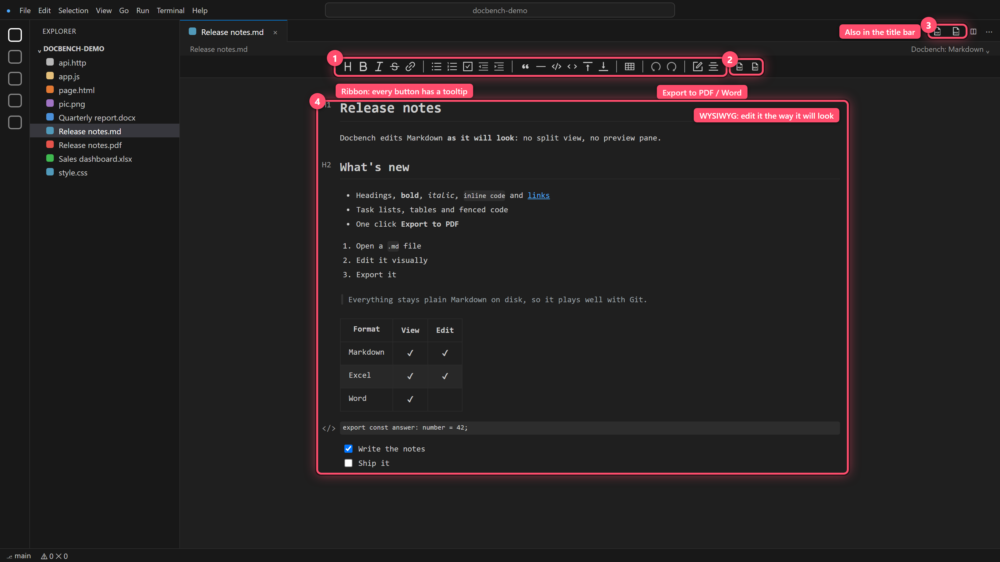
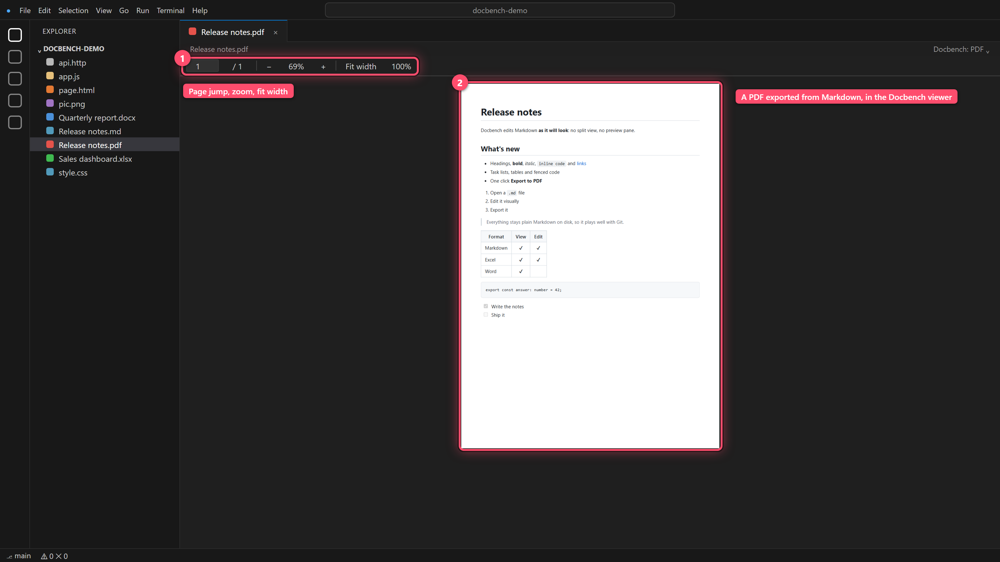
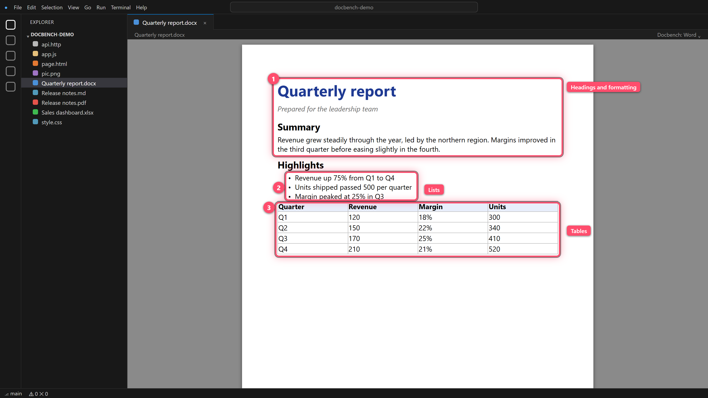
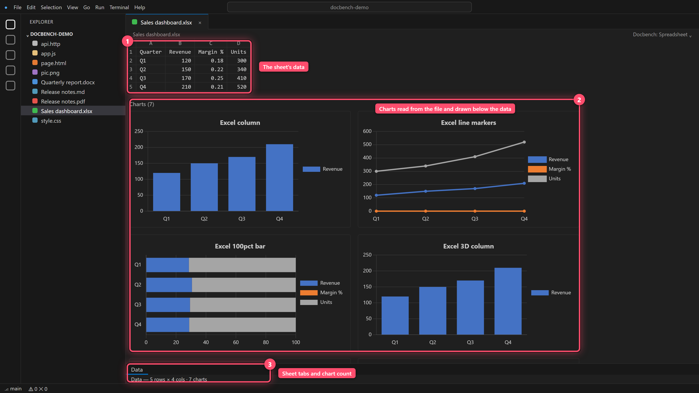
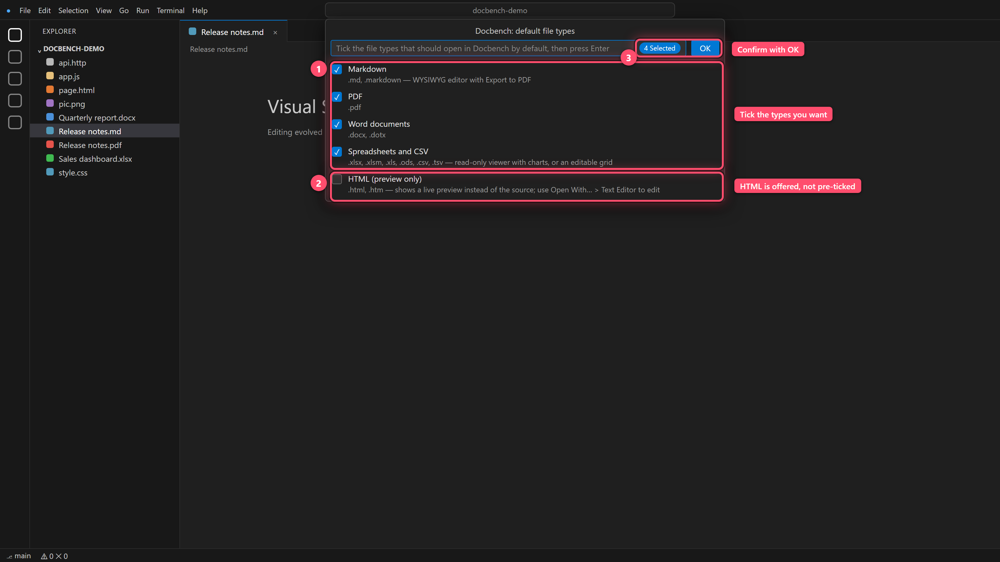

<p align="center">
  
</p>

<h1 align="center">Docbench</h1>

<p align="center">
  <b>Markdown, PDF, DOCX, XLSX / CSV and HTML files, opened right inside VS Code.</b><br>
  Open source (MIT). No telemetry.
</p>

<p align="center">
  
  
  
</p>

> **Project status:** Preview. Docbench is developed by one person, with AI assistance, and tested on Windows only. Bug reports are welcome on GitHub.

---

## What you see is what you get

The Markdown editor is a true **WYSIWYG** editor (**W**hat **Y**ou **S**ee **I**s **W**hat **Y**ou **G**et). By default there is no split view and no separate preview pane: headings, bold text, tables, task lists and code blocks look the way they will look when published, and you edit them right there. (The ribbon's *edit mode* button can still switch to Vditor's instant-rendering or split-view modes if you ever want to see the Markdown source.) The file on disk stays plain Markdown, so it works with Git and every other tool.

<p align="center">
  
</p>

1. **Ribbon.** Every button has a tooltip that says what it does and shows its shortcut.
2. **Export buttons.** One click exports the document to PDF or to Word.
3. **Title bar.** The same two exports are available as icons in the editor title bar.
4. **WYSIWYG area.** Headings, lists, tables, code and task lists look the way they will look when published.


## Why this exists

I wanted one small, open-source extension for the handful of file types I use every day: Markdown, PDF, `.docx`, `.xlsx` / `.csv`, HTML and `.http` files. Docbench is my own implementation, built on the open-source libraries listed under [Credits](#credits-and-acknowledgements). It is deliberately small; it does not try to cover every format.

## Features

### Markdown: WYSIWYG editor with PDF export
- Edit Markdown visually (powered by [Vditor](https://github.com/Vanessa219/vditor)): headings, bold, italic, strikethrough, links, bullet / numbered / task lists, indent, quotes, horizontal rules, code blocks, inline code, tables, undo / redo, and a document outline.
- Every ribbon button has a **tooltip** explaining what it does, plus its keyboard shortcut where it has one.
- Local images show up as you edit, and your relative paths are never rewritten in the file.
- The VS Code text document stays the source of truth: **undo, save, dirty markers, Git and external edits** all behave normally.
- **GitHub-flavoured Markdown**: **Mermaid diagrams** (a `mermaid` code block renders as a diagram; click it to edit the source), maths with KaTeX (`$x^2$`, `$$...$$`), syntax-highlighted code (light and dark), footnotes, and GitHub alerts (`> [!NOTE]`, `[!TIP]`, `[!IMPORTANT]`, `[!WARNING]`, `[!CAUTION]`). Everything is bundled; nothing is fetched from the internet.
- **Export to PDF** with one click (ribbon button, the PDF icon in the editor title bar, or the command **Docbench: Export Markdown to PDF**). See [PDF export](#pdf-export-from-markdown).
- **Export to Word** (`.docx`) the same way (ribbon button, editor title bar, or **Docbench: Export Markdown to Word**). Headings, bold / italic / strikethrough, links, nested bullet and numbered lists, task lists, quotes, code blocks, tables and images (PNG, JPEG, GIF, BMP) become real Word content. It needs no other software and also works in the browser version.

### PDF viewer
- Smooth continuous scrolling with pages rendered on demand, so large files stay responsive.
- Zoom in / out (or **Ctrl + mouse wheel**), **Fit width**, **100%**, and a page box to jump to any page.
- Selectable text. A PDF that needs a password shows a clear message instead.
- Uses the pdf.js engine, fully bundled; nothing is downloaded.
- Deliberately minimal: there is no search, outline, thumbnails, printing or form filling.

<p align="center">
  
</p>

1. **Toolbar.** Jump to a page, zoom in and out, fit the width, or return to 100%.
2. **Page.** A PDF that Docbench exported from the Markdown note, shown in its own viewer.


### DOCX viewer
- Read-only viewer for `.docx` and `.dotx` that keeps headings, formatting, lists, tables and images.

<p align="center">
  
</p>

1. **Headings and formatting** (colours, bold, italics) are kept.
2. **Lists** keep their bullets.
3. **Tables** keep their borders and shaded header row.


### Spreadsheets and CSV
- **Viewer** for `.xlsx`, `.xlsm`, `.xls`, `.ods`, `.csv` and `.tsv`, with sheet tabs, merged cells, and sticky column letters and row numbers. It shows cell values, not cell colours, fonts or column widths.
- **Charts are drawn** for `.xlsx` and `.xlsm` files: column, bar (stacked and 100%), line, area, pie, doughnut, scatter, bubble and radar charts, plus combination charts with a secondary axis, are read from the chart data stored in the file and shown below the sheet's data. 3D charts are drawn flat, data labels are not drawn, and charts in `.xls` / `.ods` files are not shown.
- **Editable grid** for `.xlsx`, `.xlsm`, `.xls` and `.csv`: edit cells, undo / redo and save. Choose it with **Docbench: Edit Spreadsheet in Docbench** (also in the right-click menu) or **Open With…**. Please read [the limitation](#limitations-and-known-issues): saving is lossy.

<p align="center">
  
</p>

1. **The sheet data**, with column letters and row numbers.
2. **Charts** are read from the file and drawn below the data.
3. **Sheet tabs and a chart count** at the bottom.


### HTML live preview
- Opens `.html` / `.htm` as a live preview that refreshes about 300 ms after you type (and when you save a linked file).
- Local stylesheets, scripts and images referenced with `<link>`, `<script src>`, `` and CSS `url()` are included (up to 10 MB each, 40 MB in total). Anything from the internet (scripts, stylesheets, fonts and images) is blocked.
- Press **Ctrl + Shift + V** in an HTML file to open the preview beside your source.
- The page runs in an isolated sandbox. In a workspace you have not trusted, its scripts are switched off.

### HTTP client (`.http` / `.rest`)
- Write requests in a plain text file, separate them with `###`, put the cursor in one and press **Ctrl + Enter** (or click the ▶ button in the editor's title bar).
- Variables: `@name = value` (declared above the request that uses it) then `{{name}}`, plus `{{$guid}}`, `{{$timestamp}}`, `{{$randomInt min max}}` and `{{$processEnv NAME}}` (desktop VS Code and trusted workspaces only).
- The response opens beside the file with the status, time, size, headers and a pretty-printed body (JSON), plus a **Copy body** button.
- Limits: 60 second timeout, responses over 10 MB are truncated, redirects are followed. Not supported: body includes, multipart helpers, request chaining, prompt variables and named environments.
- This is the **only** feature that makes network requests, and only when you send one. In the browser version, requests are subject to CORS.

### Make Docbench your default (optional)
Docbench **never takes over a file type on its own**. The first time you use Docbench, a one-time notification asks whether Markdown, PDF, Word and spreadsheet files should open in it by default (nothing changes unless you choose; it is skipped if you already use Docbench as a default). You can do the same at any time with **Docbench: Choose Default File Types**.

- Tick the types you want; untick to give them back. HTML is in the same list but not pre-ticked, because it shows a preview instead of the source.
- If Docbench replaces an editor you had configured for a type, it is **restored** when you untick it, and the confirmation message has an **Undo** button.
- It only edits the `workbench.editorAssociations` entry in your *User* settings. A project's own settings can still override it.

<p align="center">
  
</p>

1. **Tick the types** that should open in Docbench by default; untick to give them back.
2. **HTML** is offered too, but is not pre-ticked because it shows a preview instead of the source.
3. **OK** applies it, and an Undo button is offered afterwards.


If you prefer to stay in control manually: right-click a file and choose **Open in Docbench**, or use **Open With…**.

## Getting started

1. Install the extension (see [Installing](#installing)).
2. Open a supported file with **Open With…**, **Open in Docbench** (right-click in the Explorer or on the tab), or make Docbench the default for the types you like.
3. Hover over any button for a description of what it does.

### Installing

In VS Code, open the **Extensions** view, search for **Docbench** (publisher *Soheil Bakhshi (BI Insight)*) and click **Install**.

To install from a file instead, build or download `docbench-<version>.vsix`, then run:

```bash
code --install-extension docbench-<version>.vsix
```

or use **Extensions → ⋯ → Install from VSIX…**.

## PDF export from Markdown

Export uses a browser that is **already installed** to print the page headlessly: Edge, Chrome, Chromium or Brave are detected automatically. Nothing is uploaded and no software is installed.

- Choose where to save in the dialog, then **Open** the result or **Show in Folder**.
- Output is A4 with clean, print-friendly styling, right-to-left text support, tables, code blocks and images.
- **Local images** (relative to the Markdown file, for files on disk) and embedded images are included. **Images loaded from `http(s)://` links are not downloaded**, on purpose.
- Very long documents can hit a 90 second limit.
- To use a specific browser, set `docbench.pdfExport.browserPath`.
- Desktop VS Code only (not `vscode.dev` / `github.dev`). In remote windows (SSH, WSL, containers) the browser must be installed on the **remote** machine.

## Commands and settings

| Command | What it does |
|---|---|
| **Docbench: Choose Default File Types** | Pick which file types open in Docbench by default (with Undo) |
| **Docbench: Open in Docbench** | Open the selected file in its Docbench viewer (Explorer / tab right-click) |
| **Docbench: Edit Spreadsheet in Docbench** | Open a spreadsheet in the editable grid |
| **Docbench: Export Markdown to PDF** | Export the Markdown file you are editing |
| **Docbench: Export Markdown to Word** | Export the Markdown file you are editing as a `.docx` |
| **Docbench: Open HTML Preview** (`Ctrl+Shift+V`) | Preview the current HTML file beside the source |
| **Docbench: Send HTTP Request** (`Ctrl+Enter`) | Send the request under the cursor in a `.http` / `.rest` file |

| Setting | Default | Description |
|---|---|---|
| `docbench.markdown.loadRemoteImages` | `false` | Show `https://` images (such as badges) in the Markdown editor. Off by default so the editor makes no network requests on its own; needs a trusted workspace. Local images always show. |
| `docbench.pdfExport.browserPath` | *(empty)* | Full path to a Chromium-based browser used for PDF export. Empty means auto-detect. Machine-scoped, so a project cannot set it for you. |

## Privacy and security

- **No telemetry, no analytics and no accounts.** Docbench itself only contacts the network when you send a request from a `.http` file (or, only if you switch on `docbench.markdown.loadRemoteImages`, when the Markdown editor loads `https://` images). HTML previews do not load remote content, and PDF export does not download images.
- All viewers run in VS Code webviews with a nonce-based script policy and resources loaded through VS Code's own mechanism. The HTML preview is the exception by design: it runs your page in a sandboxed iframe (opaque origin, no popups, no navigation) under a relaxed policy, and can read files from the HTML file's folder and its workspace.
- Files are read through VS Code's file system API, so remote workspaces (SSH, containers, WSL) work.
- PDF, Word and spreadsheet files over **50 MB** are not loaded; you get a warning instead. The Markdown editor also refuses documents over 50 million characters.
- **Restricted Mode** (untrusted workspaces) is supported in a limited way: HTML preview scripts and `{{$processEnv}}` stay off until you trust the workspace. `.http` requests and PDF export still work, so only send requests from files you have read.

## Limitations and known issues

- **Tested on Windows only.** macOS and Linux are untested. The HTML preview and the `.http` client are the least-tested parts.
- **Spreadsheet editing is lossy.** Saving rewrites the file with the community edition of SheetJS: values, formulas, merged cells, column widths, row heights and hidden rows / columns are kept (and macros in `.xlsm` / `.xls` files are preserved as they are), but **cell formatting, charts, images, pivot tables, hyperlinks, comments, data validation, conditional formatting, filters, freeze panes and defined names are dropped**. Docbench asks for confirmation before the first save, and shows a notice when you open an `.xlsx` / `.xlsm` file that has charts. Use the **viewer** if you only need to look. Keep a backup.
- **Excel charts** are drawn from the data stored in the file; stock, surface, waterfall, treemap and similar chart types show a placeholder instead.
- **Word** documents are view-only, and complex layouts may not match Word pixel for pixel.
- **Markdown editor:** once you edit a file, Docbench rewrites it with its own Markdown formatter, so spacing, list markers or table layout may change (check your Git diff). Images next to your file (relative paths, including `` tags) and embedded images are shown while editing, and your paths are saved back unchanged. Images from the internet (`https://`, such as badges) are hidden by default; when a document has some, a bar at the bottom of the editor offers a one-click **Show images** button (it turns on `docbench.markdown.loadRemoteImages`). Mermaid and maths render; other diagram types (Graphviz, ECharts, PlantUML…) are shown as plain code. Editing also normalises a few things without changing their meaning: table separator rows are re-spaced, `[x]` becomes `[X]`, footnote definitions move to the end of the file, and `:emoji:` shortcodes become the emoji character.
- **Large spreadsheets** show the first ~100,000 cells per sheet.
- **PDF export** needs a Chromium-based browser installed.
- **Word export** skips SVG and WebP images (shown as `[image: …]`), leaves out images from the internet unless you have turned them on, and does not syntax-highlight code. Check complex documents in Word.
- **The browser version** (`vscode.dev` / `github.dev`) provides the Markdown editor (without PDF export), the HTML preview and the HTTP client. PDF, Word and spreadsheet files show a placeholder explaining that the desktop app is needed.
- **Not supported:** PowerPoint, legacy `.doc`, EPUB, archives, fonts, images (HEIC / TIFF / PSD), XMind, Java `.class` decompiling and Git history.

## Credits and acknowledgements

Docbench is built on these open-source libraries (all bundled, none loaded from a CDN). Full licence texts are in [THIRD-PARTY-NOTICES.md](THIRD-PARTY-NOTICES.md).

| Library | Used for | Licence |
|---|---|---|
| [pdf.js](https://github.com/mozilla/pdf.js) (`pdfjs-dist`) | PDF viewer | Apache-2.0 |
| [docx-preview](https://github.com/VolodymyrBaydalka/docxjs) | DOCX viewer | Apache-2.0 |
| [SheetJS Community Edition](https://github.com/SheetJS/sheetjs) (`xlsx`) | Reading and writing spreadsheets | Apache-2.0 |
| [x-data-spreadsheet](https://github.com/myliang/x-spreadsheet) | Editable grid | MIT |
| [Chart.js](https://github.com/chartjs/Chart.js) | Drawing spreadsheet charts | MIT |
| [JSZip](https://github.com/Stuk/jszip) | Reading chart data inside `.xlsx` files | MIT (dual-licensed) |
| [Vditor](https://github.com/Vanessa219/vditor) | Markdown WYSIWYG editor | MIT |
| [docx](https://github.com/dolanmiu/docx) | Writing Word files for Markdown export | MIT |

## About the author

I'm **Soheil Bakhshi**, a data and analytics consultant, author and Microsoft Data Platform MVP based in New Zealand. I work mainly with Power BI and Microsoft Fabric, with a growing focus on agentic AI and agentic BI: AI agents that build, document and maintain analytics solutions. I write about all of it at [biinsight.com](https://www.biinsight.com). You can find my MVP profile [here](https://mvp.microsoft.com/en-US/MVP/profile/3c172d61-65c9-e911-a99c-000d3a137063).

## Building from source

```bash
npm install
npm run compile      # bundles the extension and all viewers
npm run package      # produces docbench-<version>.vsix
```

Press **F5** in VS Code to launch an Extension Development Host. The logo and its design notes are in [assets/](assets/).

## License

[MIT](LICENSE) © 2026 Soheil Bakhshi. Third-party licences are in [THIRD-PARTY-NOTICES.md](THIRD-PARTY-NOTICES.md).
